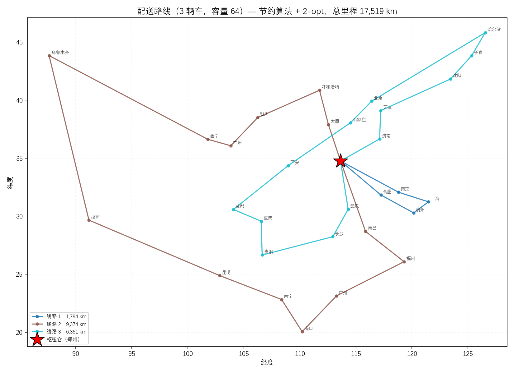
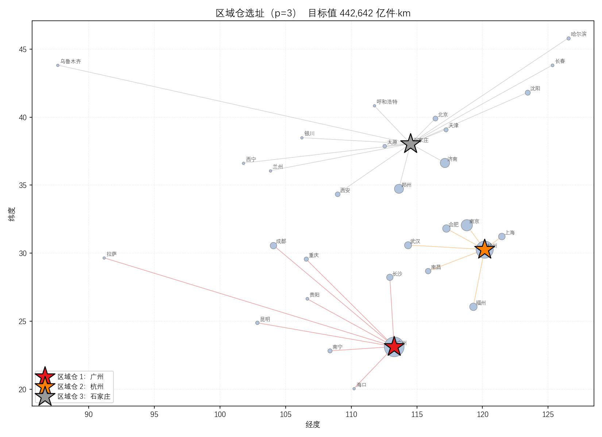

# 物流运筹优化：车辆路径 + 设施选址

用 **真实快递业务量数据** 做两个经典的物流运筹问题：配送路线优化、区域仓选址。
算法全部手写实现（numpy + pandas），**不依赖 OR-Tools 或其他求解器**。

---

## 一、为什么手写算法

原本打算用 OR-Tools，但本机 Windows 的 Smart App Control 处于强制状态，
拦截了 OR-Tools 未签名的原生 DLL：

```
OSError: [WinError 4551] 应用程序控制策略已阻止此文件
```

绕不过去（除非关闭 Smart App Control，而它一旦关闭只能靠重装系统重新开启）。

**手写之后反而有个意外的好处**：算法每一步都能讲清楚，结果可复现、可验证，
而且节约算法和 2-opt 本身就是物流工程的专业课内容。
面试时能解释原理，比只能说「我调了个库」有价值得多。

---

## 二、数据

| 数据 | 来源 | 说明 |
|---|---|---|
| 各省快递业务量 | [stage1-real-data](../stage1-real-data/) 抓取的国家邮政局公报 | **真实数据**，2024 年全年 |
| 省会经纬度 | `data/province_capitals.csv` | 人工维护的公开地理数据 |
| 城市间距离 | haversine 球面距离 | 见下方局限说明 |

**距离自检**（与常识里程对照）：

| 路线 | 计算值 | 实际直飞距离 |
|---|---|---|
| 北京 → 上海 | 1,067 km | ≈ 1,067 km |
| 广州 → 北京 | 1,889 km | ≈ 1,890 km |
| 乌鲁木齐 → 上海 | 3,268 km | ≈ 3,270 km |

**需求量缩放**：真实业务量跨 3 个数量级（广东 425.9 亿件 vs 西藏 0.3 亿件）。
按「10 亿件 = 1 个需求单位」压缩，并对不足 10 亿件的省份保底给 1 单位：

```
demand_units = max(1, round(volume_yi / 10))
```

原始 `volume_yi` 列完整保留，任何结论都能回溯。

---

## 三、问题一：车辆路径问题（CVRP）

### 设定

- **1 个枢纽仓**：郑州（地理居中，实际也是全国性物流枢纽）
- **30 个客户城市**：其余各省会
- **4 辆车**，每辆容量 48 单位（总运力 192，需求总量 173，利用率 90%）
- **目标**：总行驶里程最短

### 算法

**构造：Clarke-Wright 节约算法**

```
1. 初始：每个城市单独一条线路（郑州 → 城市 → 郑州）
2. 计算任意两城合并能省多少：
       saving(i,j) = d(0,i) + d(0,j) − d(i,j)
3. 按 saving 从大到小排序，依次尝试合并
4. 合并条件：i、j 分别在两条线路的端点，且合并后不超车辆容量
```

**改进：2-opt 局部搜索**

线路内反转一段区间，距离变短就保留，反复直到没有改进。

**对照：最近邻法**——从仓库出发每次去最近的未访问城市，装不下就回车换车。
这是最直觉的做法，用来衡量节约算法到底赚了多少。

### 结果

| 方案 | 线路数 | 总距离 (km) | 相对最优 |
|---|---|---|---|
| 最近邻（朴素） | 4 | 25,184 | +26.9% |
| 最近邻 + 2-opt | 4 | 23,124 | +16.5% |
| 节约算法 | 4 | 19,926 | +0.4% |
| **节约算法 + 2-opt** | 4 | **19,846** | **0（最优）** |

**比朴素最近邻节省 5,338 km，降幅 21.2%。**



### 两个洞察

**1. 好的构造算法比事后改进更值钱。**

节约算法单独用就已经比最近邻好 20.9%，而 2-opt 只再挤出 0.4%。
原因是节约算法从一开始就把「合并能省多少」写进了构造过程，
而最近邻是短视的——每次只挑最近的一个点，在长距离场景下很容易绕远路。

**2. 货量分布决定了路线结构的不均衡。**

最优方案里，一条线路跑 19 个省（11,365 km），另外三条只跑 3~4 个省。
原因不是算法有问题，而是需求极度偏斜：广东一个省就占 43 单位，
接近一辆车的全部容量。**这种不均衡是数据本身的特征，不是算法的缺陷。**

---

## 四、问题二：设施选址（p-median）

### 设定

从 31 个省会中选 **p 个建区域仓**，让「所有需求点送到最近仓库」的总运输量最小：

```
minimize  Σ_i  weight_i × distance(i, 最近的仓库)
```

单位是 **「亿件·公里」**——不是让距离最短，而是让**货量大的地方离仓库近**。

### 算法：精确解 + 贪心对照

| 解法 | 做法 | 性质 |
|---|---|---|
| **穷举** | C(31,3) = 4,495 种组合全算一遍 | 绝对最优，耗时 0.02 秒 |
| **贪心** | 每次选边际收益最大的点，重复 p 次 | 快，但不保证最优 |

> 规模小的时候，穷举就是最好的算法——简单、绝对正确、不需要任何库。
> 用贪心做对照，是为了量化「启发式到底差多少」。

### 结果（p = 3）

| 解法 | 区域仓 | 目标值（亿件·km） |
|---|---|---|
| **穷举（最优）** | **广州 / 杭州 / 石家庄** | **442,642** |
| 贪心 | 合肥 / 广州 / 石家庄 | 522,789（**+18.11%**） |



### 贪心为什么差 18%

贪心在 p=1 时选了地理最居中的**合肥**，然后**无法撤销**。
到第 3 个仓时，它需要的是杭州（浙江 321.9 亿件，全国第二大），
但合肥已经在华东占位，选杭州的边际收益看起来不够高，于是错过。

> **这就是贪心的本质缺陷：每步都做局部最优，且不能回头。**
> 在 p=3 这种小规模问题上，穷举只要 0.02 秒，没有任何理由用贪心。

### 灵敏度：到底该建几个仓

| p | 最优目标值 | 相对上一档改善 | 穷举耗时 |
|---|---|---|---|
| 1 | 1,175,724 | — | 0.00s |
| 2 | 674,938 | **42.6%** | 0.00s |
| 3 | 442,642 | **34.4%** | 0.02s |
| 4 | 356,541 | 19.5% | 0.17s |
| 5 | 304,700 | 14.5% | 0.96s |

**边际收益明显递减。** 第 2 个仓带来 42.6% 的改善，第 5 个只有 14.5%。
这个曲线是决定「建几个仓」的主要依据——再往后加仓，投入产出比越来越差。

### 一个反直觉的验证

最优方案里拉萨被分给了**广州**，看起来不合理（拉萨明明在西部）。

实算结果：

| 路线 | 距离 |
|---|---|
| 拉萨 → 广州 | **2,312 km** |
| 拉萨 → 石家庄 | 2,340 km |

**广州确实近 28 公里。** 拉萨与广州纬度更接近，虽然经度跨度大，但球面距离反而略短。

> 这类「直觉和计算不一致」的地方，一定要回去算一遍。
> 如果只凭地图印象就断言「拉萨该归西部仓」，整个结论的可信度就没了。

---

## 五、目录结构

```
optimization/
├── src/
│   ├── build_data.py         # 省份坐标 + 真实业务量 → 客户表、距离矩阵
│   ├── vrp_solver.py         # CVRP：节约算法 + 2-opt，含最近邻对照
│   └── facility_location.py  # p-median：穷举精确解 + 贪心对照 + 灵敏度
├── data/
│   ├── province_capitals.csv # 31 个省会经纬度（人工维护）
│   ├── customers.csv         # 由 build_data.py 生成
│   └── distance_matrix.csv   # 球面距离矩阵
└── output/
    ├── vrp_routes.png
    ├── vrp_summary.csv
    ├── vrp_routes.csv
    ├── facility_optimal.png
    ├── facility_solution.csv
    └── facility_sensitivity.csv
```

---

## 六、运行

```bash
# 1. 先准备数据（会读 ../stage1-real-data/data/raw/spb_province.csv）
python src/build_data.py

# 2. 车辆路径（可调车辆数/容量）
python src/vrp_solver.py --vehicles 4
python src/vrp_solver.py --vehicles 3

# 3. 设施选址（可调仓数）
python src/facility_location.py --p 3
python src/facility_location.py --p 4
```

依赖：`numpy` `pandas` `matplotlib`（不需要 OR-Tools）

```bash
pip install -r requirements.txt
```

---

## 七、已知局限

1. **用球面距离，不是路网距离**。真实公路里程通常是直线的 1.2~1.4 倍。
   这不影响路线**结构**的优化，但绝对里程不能直接当运费算。
2. **车辆同质**。实际车队有不同吨位，是异构车队问题（HFVRP）。
3. **没有时间窗**。真实配送常要求「几点前送达」，那是 VRPTW，难度高一个量级。
4. **没有考虑回程空载**。实际可以顺路集货，是取送货一体问题（VRPSPD）。
5. **距离矩阵对称**。真实路网有单行道、限行，A→B 与 B→A 可能不同。
6. **选址只考虑运输成本**，没有算建仓固定成本、地价、政策因素。
   如果加入固定成本，就变成「设施选址 + 数量决策」的联合问题。
