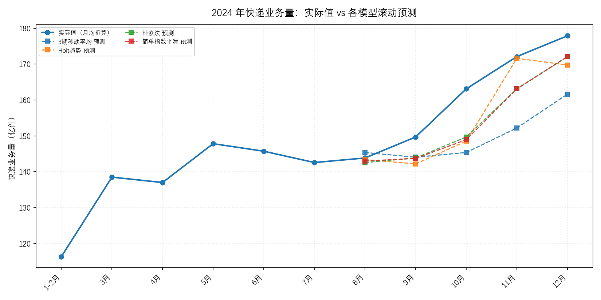

# 中国快递物流数据仓库

基于**国家邮政局官方公报**抓取、清洗、入库的快递物流数据集，按 ODS → DWD → DWS → ADS 四层建模，输出可直接对接 Power BI / Streamlit 的应用层宽表。

---

## 一、这个项目解决什么问题

网上关于「中国快递物流」的数据要么是爬来的脏数据，要么是付费数据库。本项目直接从**国家邮政局官网的原始公报**里结构化抽取，每一行记录都保留 `source_url`，可**逐条回溯核对**。

同时，官方公报本身有三个真实的工程问题，本项目逐一处理了：

| 问题 | 具体表现 | 处理方式 |
|---|---|---|
| **单位不统一** | 2021 年公报用「万件/万元」，2024 年改用「亿件/亿元」 | 解析时读取表头识别单位，统一换算为亿件/亿元 |
| **表格结构不固定** | 1 月份的公报没有「累计」列，只有当月值 | 解析器兼容 4 列和 6 列两种结构 |
| **报告期不规整** | 月度、半年、季度累计、年度混排 | 用 `period_type` + `period_end_month` 显式标注，不硬凑成连续序列 |

---

## 二、数据来源

**国家邮政局**「邮政行业运行情况」系列公报 — https://www.spb.gov.cn

每篇公报包含两类 HTML 表格：

1. **全国邮政行业发展情况表** — 快递业务量/收入，累计值、当月值、同比增速
2. **分省表** — 31 个省 + 全国的业务量、收入、同比
3. **城市 TOP50 表** — 按业务量和业务收入分别排名的前 50 个城市

> ⚠️ **注意**：2024 年之后的公报把城市表改成了**图片**（政府网转载版更是整页都是图），
> 只有 2021–2023 年的页面带 HTML 城市表。因此城市数据的报告期是 **21 个不连续的期间**，不是完整月度序列。
>
> 另外一个坑：**单位在不同年份之间会变**。2021 年用「万件/万元」，2024 年改用「亿件/亿元」，
> 2024 年内部还混着两种（`c100015` 栏目用万件、`c100276` 栏目用亿件），必须逐表读表头判断。

---

## 三、目录结构

```
stage1-real-data/
├── scripts/
│   ├── fetch_spb.py             # 抓取 + 解析公报 → data/raw/*.csv
│   ├── load_mysql.py            # 建库建表 → 装载 → 校验 → 导出 ADS 到 Excel
│   └── build_monthly_series.py  # 用累计值差分还原连续月度序列
├── analysis/
│   └── forecast.py              # 需求预测：基准 + 指数平滑 + Holt，滚动验证
├── sql/
│   └── 01_schema.sql            # ODS 建表 + DWD/DWS/ADS 全部视图（幂等）
├── data/
│   ├── raw/
│   │   ├── spb_national.csv     # 全国汇总   125 行
│   │   ├── spb_province.csv     # 分省数据   672 行
│   │   └── spb_city.csv         # 城市数据  1142 行
│   └── processed/
│       └── monthly_volume_2024.csv  # 2024 年月度业务量序列（11 个点）
├── output/
│   ├── 快递物流分析_ADS.xlsx      # 5 个 sheet，直接喂 Power BI
│   ├── forecast_2024.png         # 实际值 vs 各模型滚动预测
│   └── forecast_comparison.csv   # 每个模型每一步的预测误差明细
├── .env.example
└── requirements.txt
```

---

## 四、快速开始

```bash
# 1. 安装依赖
pip install -r requirements.txt

# 2. 配置数据库（复制后用记事本填入你的 MySQL 密码）
copy .env.example .env

# 3. 抓取数据
python scripts/fetch_spb.py

# 4. 建仓 + 装载 + 导出
python scripts/load_mysql.py

# 5. 还原连续月度序列（需求预测的输入）
python scripts/build_monthly_series.py --year 2024
```

**前置条件**：本地 MySQL 8.0+ 已启动。脚本会自动创建 `logistics_dw` 库，**不会影响你原有的数据库**。

> Windows 用户请在 **Anaconda Prompt** 里执行，不要用系统 PowerShell（python 可能不在 PATH 里）。

---

## 五、数据仓库分层

```
国家邮政局公报 (HTML)
        │  fetch_spb.py 抓取 + 解析
        ▼
   data/raw/*.csv
        │  load_mysql.py 装载
        ▼
┌─────────────────────────────────────────────────┐
│ ODS 原始层                                       │
│   ods_spb_national / ods_spb_province            │
│   ods_spb_city                                   │
│   字段与源一致，不做业务加工                      │
└─────────────────────────────────────────────────┘
        │  类型规范、口径统一、派生度量
        ▼
┌─────────────────────────────────────────────────┐
│ DWD 明细层                                       │
│   dwd_period       报告期主数据                  │
│   dwd_city         城市明细（含单票收入 元/件）   │
│   dwd_province     分省明细（关联东中西区域）     │
└─────────────────────────────────────────────────┘
        │  按分析主题聚合
        ▼
┌─────────────────────────────────────────────────┐
│ DWS 汇总层                                       │
│   dws_city_concentration   CR5 / CR10 集中度      │
│   dws_region_share         东中西区域占比         │
└─────────────────────────────────────────────────┘
        │  面向分析场景
        ▼
┌─────────────────────────────────────────────────┐
│ ADS 应用层（供 BI 直接取数）                      │
│   ads_city_network     城市网络 + 帕累托 + 分级   │
│   ads_national_trend   全国趋势                   │
│   ads_province_compare 分省对比 + 排名            │
└─────────────────────────────────────────────────┘
```

---

## 六、关键分析结论

### 1. 「最忙的城市」不等于「最赚钱的城市」

2024 年全年数据：

| 城市 | 业务量（亿件） | 收入（亿元） | 单票收入（元/件） |
|---|---|---|---|
| 金华市 | 171.9 | 419.5 | **2.44** |
| 广州市 | 142.5 | 986.2 | 6.92 |
| 深圳市 | 76.7 | 657.0 | 8.57 |
| 上海市 | 49.5 | **2519.2** | **50.89** |

- **金华（义乌）**业务量全国第一，但单票收入只有 **2.44 元** —— 典型的小商品低价件结构
- **上海**业务量排第 4，收入却是全国最高，单票收入 **50.89 元，是金华的 21 倍** —— 高附加值件、国际件集中

> 业务含义：**不能用单一指标衡量一个城市的物流价值。**
> 对快递公司来说，金华是「规模战场」，上海是「利润战场」，两者的运营策略（分拨投入、干线班次、产品定价）完全不同。

### 2. 城市集中度在下降

| 报告期 | CR5 | CR10 |
|---|---|---|
| 2021年1月 | 39.62% | 54.62% |
| 2024年全年 | **36.99%** | **51.58%** |

前 5 / 前 10 城市的业务量占比持续下降，说明**增量正在向中西部和下沉市场转移**。

### 3. 东中西结构

2024 年全年：东部 72.38% / 中部 18.73% / 西部 8.89%（业务量）

### 4. 2024 年月度业务量序列（需求预测的输入）

用「本期累计 − 上期累计」把不连续的公报还原成连续月度序列：

| 月份 | 业务量（亿件） | 数据来源 |
|---|---|---|
| 1-2月 | 232.61 | 合并区间（春节扭曲，官方也常合并） |
| 3月 | 138.49 | 原始差值 |
| 4月 | 136.99 | 原始差值 |
| 5月 | **147.82** | **推导拆分**（1-6月累计 − 1-4月累计 − 6月当月） |
| 6月 | 145.71 | 原始差值 |
| 7月 | 142.56 | 原始差值 |
| 8月 | 143.83 | 原始差值 |
| 9月 | 149.69 | 原始差值 |
| 10月 | 163.10 | 原始差值 |
| 11月 | 172.10 | 原始差值（双十一） |
| 12月 | 177.90 | 原始差值（双十二 + 年货节） |
| **合计** | **1750.80** | **与官方公布的 2024 年全年累计完全一致** |

> **校验方式**：11 个点相加 = 1750.80 亿件，等于官方全年累计值。
> 这是还原逻辑正确性的最强证据 —— 差分不会凭空造数据，也不会丢数据。
>
> **每条记录的 `derive_method` 字段标明来源**（原始差值 / 推导拆分 / 合并区间），
> 不做无依据的插值。序列形状也符合业务常识：季末冲量、Q4 双峰。

---

## 七、需求预测

用上面还原出的 2024 年月度序列做滚动预测，代码在 `analysis/forecast.py`。



### 为什么不做季节模型

只有 **1 年、11 个点**。Holt-Winters / SARIMA 这类带季节项的模型至少需要 **2 个完整周期（24 个月）**，
否则季节项只能从单次观测里硬拗，属于过拟合。所以这里只用「水平 + 趋势」类方法，并把这一点写进结论。

> 「1-2月」是合并区间，直接放进去会形成假尖峰（232 vs 常态 140+），
> 因此按**月均折算**（232.61 / 2 = 116.31）后再建模。

### 方法

| 类型 | 模型 | 说明 |
|---|---|---|
| 基准 | 朴素法 | 用上一期值预测下一期 |
| 基准 | 3 期移动平均 | 最近 3 个月平均 |
| 模型 | 简单指数平滑 SES | 只有水平项 |
| 模型 | Holt 线性趋势 | 水平 + 趋势项 |

### 评估方式：滚动起点验证（walk-forward）

样本只有 11 个点，**不做固定比例的训练/测试划分** —— 那样测试集只剩 3 个点，误差估计不可靠，
而且那 3 个点只测不学，信息白白浪费。

改用滚动验证：从第 6 个点开始，每次用 `y[:k]` 训练、预测 `y[k]`，窗口逐步扩张，得到 5 次独立预测。

### 结果

| 模型 | MAE | MAPE | RMSE |
|---|---|---|---|
| **Holt 趋势** | 6.23 | **3.82%** | 8.19 |
| 朴素法（基准） | 7.07 | 4.30% | **8.13** |
| 简单指数平滑 | 7.16 | 4.35% | 8.39 |
| 3 期移动平均 | 12.22 | 7.28% | 14.21 |

### 三个诚实结论

**1. Holt 赢了，但赢得很勉强 —— 只比朴素法好 0.48 个百分点。**

说明这条序列的趋势信息很弱，或者 11 个样本不足以让趋势模型发挥优势。
诚实的说法是「在本数据上趋势模型增量有限」，而不是宣称「模型准确率 96%」。

**2. MAPE 和 RMSE 给出了相反的答案。**

```
MAPE 最优：Holt 趋势      RMSE 最优：朴素法
```

查下去发现原因在 **10 月**：Holt 预测 148.52，实际 163.10，**单点误差 14.58 亿件**，
而它其余四步误差都在 0.3~7.5 之间。

- MAPE / MAE 一视同仁地平均 → 四次准 + 一次偏，平均下来仍是第一
- RMSE 对误差取平方 → 14.58 变成 212，一个离群点就拉垮总分

> **业务含义**：平均指标会掩盖单点风险。如果这是真实排产，那一次漏判旺季跳升
> 就足以导致爆仓。**所以评估模型不能只看一个数。**

**3. 3 期移动平均明显不可用**，MAPE 7.28%，在上升趋势里系统性滞后约 1.5 个月。

### 已知局限

- 样本仅 11 个点，所有误差指标的置信区间都很宽
- 没有 2025 年真实月度数据可做外部验证，因此上面的 MAPE 是**样本内**滚动指标，偏乐观
- 未考虑春节、双十一等事件的显式建模

---

## 八、已知局限

1. **城市数据只有 21 个不连续报告期** — 因为官网 2024 年后把城市表改成了图片
2. **官网列表页分页由 JS 驱动**，无法一次性枚举全部历史公报，覆盖率取决于 `fetch_spb.py` 里的种子 URL 列表
3. **5 篇公报未能解析** — 其中政府网转载版整页是图片（0 个 HTML 表格），其余是正文结构不同的通报
4. 城市表只有 TOP50，不是全量城市
5. **需求预测样本仅 11 点**，见上一节「已知局限」

---

## 九、后续计划

- [x] 基于还原的月度序列做需求预测（指数平滑 / Holt，含 MAE、MAPE、RMSE 评估与滚动验证）
- [ ] 补充更多历史公报的 URL，扩大时间覆盖
- [ ] 对城市表做 OCR，把 2024 年之后的图片数据也纳入
- [ ] 加入 ARIMA / SARIMA 做对比（需先补足 24 个月以上数据）
- [ ] 基于城市数据做选址与车辆路径优化（OR-Tools）
- [ ] 用 Streamlit 部署在线看板，替换现有 Power BI 静态截图

---

## 十、技术栈

Python 3.10+ · pandas · statsmodels · matplotlib · MySQL 8.0+ · SQLAlchemy · PyMySQL · Power BI

## License

MIT
